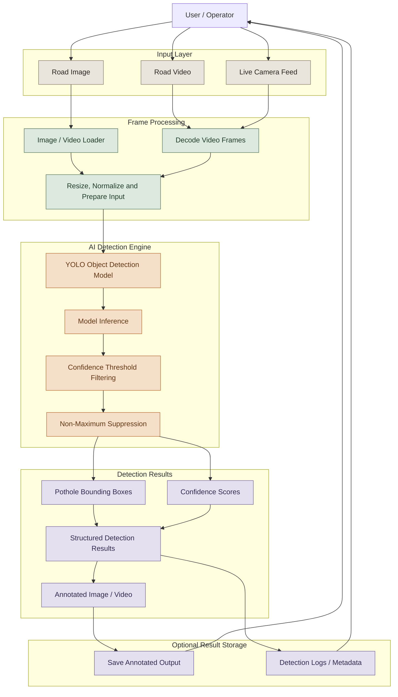

# PotHole Detector

**AI-powered road pothole detection using computer vision and deep learning.**

PotHole Detector is a computer-vision project designed to identify potholes in road images and video streams using object detection. It processes visual input, detects potential road damage, and generates detection results that can support road inspection, maintenance planning, and infrastructure monitoring.

The project aims to make pothole identification faster, more consistent, and easier to integrate into road-monitoring workflows.

## Key Features

- **AI-Based Detection:** Identify potholes using a trained object-detection model.
- **Image Inference:** Analyze road images and return detection results.
- **Video Inference:** Process video frames to detect potholes across a recording.
- **Bounding-Box Visualization:** Mark detected potholes with bounding boxes and confidence scores.
- **Configurable Inference:** Support configurable model weights, confidence thresholds, and input sources.
- **Terminal-Based Execution:** Run detection and inspect results directly from the command line.
- **Extensible Architecture:** Provide a foundation for future road-condition analytics and real-time monitoring.

Actual capabilities depend on the model weights, datasets, and inference pipeline configured in the repository.

## System Architecture

The following diagram illustrates the end-to-end detection pipeline, from road footage to annotated output.



*Architecture note: Live-camera inference, persistent logging, and storage are shown as possible extensions. Retain these components in the diagram only if they exist in the actual implementation.*

## Detection Workflow

1. **Input:** Load a road image or video.
2. **Preprocessing:** Prepare the image or decoded video frame for inference.
3. **Inference:** Pass the input through the configured YOLO detection model.
4. **Filtering:** Apply confidence thresholds and detection post-processing.
5. **Localization:** Generate bounding boxes around detected potholes.
6. **Visualization:** Display or save annotated images and video.
7. **Results:** Return detection metadata and confidence scores.

## Technology Stack

| Component | Technology |
|---|---|
| Programming language | Python |
| Object detection | YOLO |
| Computer vision | OpenCV |
| Deep learning | PyTorch, where used by the model |
| Execution interface | Command-line terminal |
| Model weights | Configured YOLO checkpoint |

The precise model version, training dataset, and dependencies should match the repository's actual configuration.

## Getting Started

### Prerequisites

- Python version supported by the project's dependencies.
- Git.
- Model weights compatible with the inference implementation.
- Required Python packages from the project's dependency file.

### Clone the repository

```bash
git clone https://github.com/reddy895/PotHole-Detector.git
cd PotHole-Detector
```

### Install dependencies

Use the repository's existing dependency file and setup instructions. For a project using `requirements.txt`, the typical installation command is:

```bash
python -m venv .venv
source .venv/bin/activate
pip install -r requirements.txt
```

On Windows, activate the environment using `.venv\Scripts\activate`.

### Run detection

Use the actual entry point and arguments defined in the repository. For example, if the implementation exposes `main.py`:

```bash
python main.py
```

Ensure the configured model weights and input paths are available before running inference.

## Output

Depending on the implementation, the detector can produce:

- Bounding boxes around detected potholes.
- Confidence scores for detections.
- Annotated road images or videos.
- Structured detection metadata.
- Terminal logs describing inference results.

A detection is a model prediction, not a certified assessment of road damage. Performance depends on training data, lighting, camera angle, road conditions, and the selected confidence threshold.

## Potential Applications

- Road inspection and maintenance workflows.
- Preliminary road-damage surveys.
- Visual analysis of recorded road journeys.
- Infrastructure monitoring research.
- Integration into vehicle-mounted or roadside camera systems.

## Future Improvements

- Real-time camera inference.
- Pothole size and severity estimation.
- GPS-based location tagging.
- Geospatial pothole mapping.
- Detection tracking across video frames.
- Road-condition reporting and maintenance prioritization.
- Model evaluation across different lighting and weather conditions.

## Contributing

Contributions are welcome. Keep model inference, input handling, visualization, and evaluation logic modular. Add tests for new functionality and document any new model or dataset requirements.

## License

Refer to the repository's `LICENSE` file for licensing terms.

---

**PotHole Detector — Turning road imagery into actionable pothole detections.**
